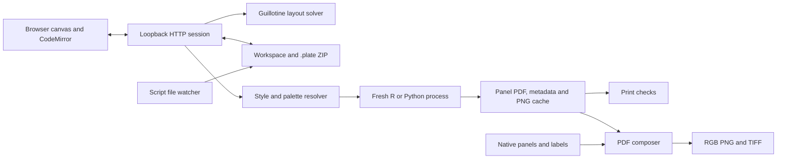
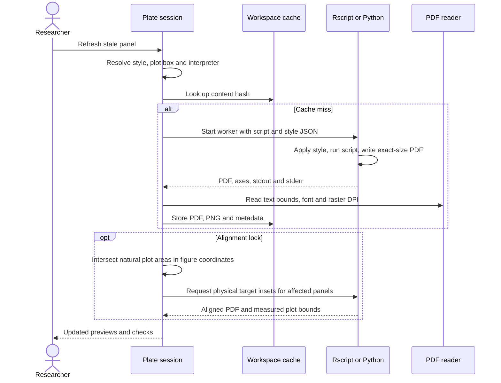

# Architecture

Plate uses Python for physical geometry, workspace I/O, subprocess management and PDF composition. PyMuPDF provides PDF parsing, vector placement and rasterization. Pillow writes DPI-tagged RGB files and handles image input. FontTools resolves names in the installed font collection. The browser uses ES modules and CodeMirror 6. The app starts with the standard-library HTTP server on a random 127.0.0.1 port.

## Project and solver

`Project` stores `FigureSize`, style tokens, palette records, semantic colours, interpreter paths, panel settings and the split tree. `FigureSize` stores the journal ID, width, height and minimum panel span in mm. Spacing tokens store the margin and gutter. Panel IDs identify the leaves and workspace files. Geometry is derived from the split tree and all text and stroke sizes are stored in pt.

The solver recursively computes the minimum and optional fixed span in both dimensions. A split sums its children and gutters along its axis. Perpendicular to the split it uses the greatest child minimum and reconciles fixed spans. The top-down pass distributes each span by weight after reserving fixed spans, and clamps any undersized child before redistributing. Every layout operation validates the candidate before committing it. Resize operations link collinear gutters and clamp to the capacity shared by all affected splits. Numeric changes act on the same gutters. The browser keeps project snapshots for undo and redo and previews a drag locally until the release submits a solver operation.

The ZIP format separates `manifest.json`, `layout.json`, `style.json`, `palettes.json`, panel metadata and real script files. Imported assets use content-addressed paths. The loader validates entry names and invokes the schema migration hook. The workspace stores autosaved metadata. Save writes a sibling temporary ZIP and renames it over the destination.

## Rendering

Every script runs in a fresh process group. R starts with `--vanilla`, Python uses a noninteractive Matplotlib backend, and the workers receive context through `PLATE_STYLE`. Scripts run from the data root. A timeout terminates the process group. The cache keys contain source, resolved context, content size, interpreter path and version, working directory and the render contract version. An alignment group adds the member signatures and positions to the refresh state. The data root remains user-managed, so the cache does not watch external data files.

Matplotlib uses native points. In ggplot2, text geom size is `pt / .pt` and theme text size is already in points. Grid linewidth is `pt × 96 / 72`, so a ggplot2 linewidth is `pt × 96 / 72 / .pt`. Cairo's whole-point MediaBox is reset to the fractional physical size without transforming its drawing stream. Matplotlib alignment repositions the outermost axes and their relative arrangement. ggplot2 and patchwork use fixed physical outer gtable tracks to shrink the flexible plot region. Base R uses `par(plt)`.

PDF composition places each panel as one page-level Form XObject and removes the wrapper added by the placement API. The form can contain genuine plot marker resources and source clipping. Native labels join the same form, with font dictionaries named by their PostScript names for editor matching. Imported rasters retain their original pixel dimensions. Raster export derives its dimensions from the final PDF and writes DPI metadata.

Script synchronization uses a workspace poll and a compare-before-write save. Figure metadata writes preserve external script changes. The browser compares saved source against its draft base and prompts when both changed.
