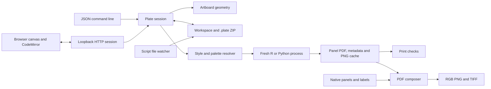
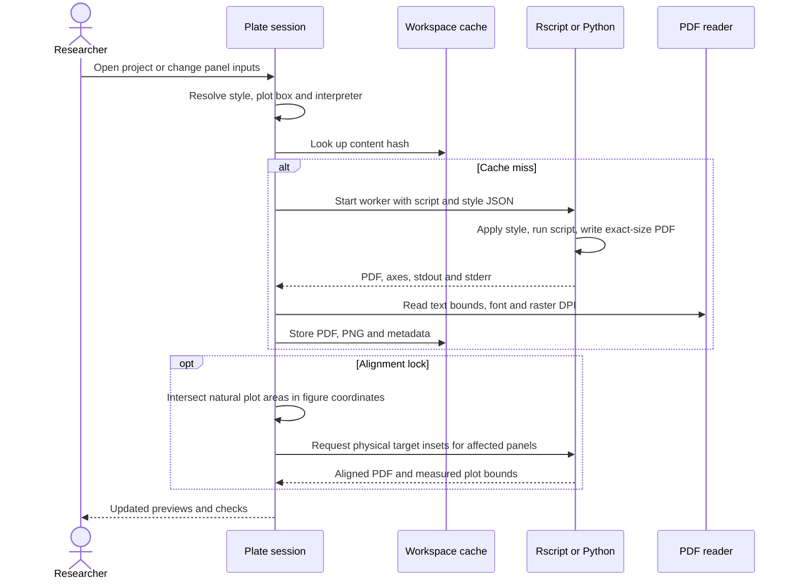

# Architecture

Plate uses Python for physical geometry, workspace I/O, subprocess management and PDF composition. PyMuPDF provides PDF parsing, vector placement and rasterization. Pillow writes DPI-tagged RGB files and handles image input. FontTools resolves names in the installed font collection. The browser uses ES modules and CodeMirror 6. The app starts with the standard-library HTTP server on a random 127.0.0.1 port.

The macOS app uses a Swift AppKit shell and WKWebView with the same Python server and web files. The shell owns its backend through a pipe that closes on quit, supplies a per-launch loopback credential, and exposes native file pickers to the workspace. Desktop and browser sessions use separate working directories and share the `.plate` format. [Desktop build and testing](docs/macos.md)

The CLI opens a temporary workspace for each invocation and uses the same session methods as the browser. The saved bundle carries the layout, scripts, imported assets and render cache between invocations. [Command reference](docs/cli.md)

## Project and layout

`Project` stores a figure size and an independent artboard rectangle for each panel. Positions, dimensions and the snap interval use mm. Typography and stroke widths use pt. Panel list order defines stacking from back to front in the canvas and in export.

The browser snaps pointer and keyboard edits to the grid and previews them locally. The server validates the final rectangle, including artboard bounds and any locked dimensions. Numeric edits keep their exact measurements. When a legacy split-tree bundle opens, Plate resolves its existing geometry into independent rectangles. The browser keeps project snapshots for undo and redo.

The ZIP format separates `manifest.json`, `layout.json`, `style.json`, `palettes.json`, panel metadata and real script files. Imported assets use content-addressed paths. The loader validates entry names and invokes the schema migration hook. The workspace stores autosaved metadata. Save writes a sibling temporary ZIP and renames it over the destination.

## Rendering

Every script runs in a fresh process group. R starts with `--vanilla`, Python uses a noninteractive Matplotlib backend, and the workers receive context through `PLATE_STYLE`. Scripts run from the data root. A timeout terminates the process group. The cache keys contain source, resolved context, content size, interpreter path and version, working directory, declared input content fingerprints and the render contract version. The browser polls for stale panels with declared inputs. A workspace-local data folder override lives in the library record. An alignment group adds the member signatures and dimensions to the refresh state. Plot alignment shares physical insets from each panel’s edges, so the plot area follows its panel dimensions. Moving a panel shifts its axes along with it and reuses its render.

The workers record interpreter and loaded package versions. Plate adds font information from the rendered PDFs and saves the record in `provenance.json` independently of the preview cache. Environment comparison uses the saved record as the baseline after a bundle is reopened.

A refresh runs up to three plotting subprocesses at once. Each alignment pass waits for its input measurements. The request thread processes the PDFs and records results as subprocesses finish. Plate shares Matplotlib's font inventory across workspaces so opening another figure can reuse it.

Matplotlib uses native points. In ggplot2, text geom size is `pt / .pt` and theme text size is already in points. Grid linewidth is `pt × 96 / 72`, so a ggplot2 linewidth is `pt × 96 / 72 / .pt`. Cairo's whole-point MediaBox is reset to the fractional physical size without transforming its drawing stream. Matplotlib alignment repositions the outermost axes and their relative arrangement. ggplot2 and patchwork use fixed physical outer gtable tracks to shrink the flexible plot region. Base R uses `par(plt)`.

PDF composition places each panel as one page-level Form XObject and removes the wrapper added by the placement API. The form can contain genuine plot marker resources and source clipping. Native labels join the same form, with font dictionaries named by their PostScript names for editor matching. Imported rasters retain their original pixel dimensions. Raster export derives its dimensions from the final PDF and writes DPI metadata.

Script synchronization uses a workspace poll and a compare-before-write save. Figure metadata writes preserve external script changes. The browser compares saved source against its draft base and prompts when both changed.
